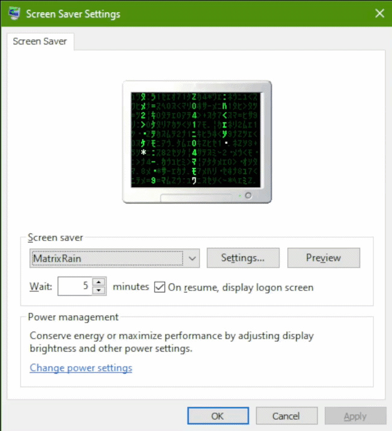

# MatrixRain

A Windows screensaver that draws a Matrix-style "digital rain" effect, with a
configurable character set, colour, density, and speed. Built on .NET 9 +
WinForms. No third-party packages.

<p align="center">
  
</p>

## Features

- Fullscreen on every monitor; integrates with the standard Windows screensaver
  flow (right-click `.scr` → Install, live preview thumbnail in *Screen Saver
  Settings*, idle-trigger via the "Wait" timer).
- Starts on a clean black void; the first rain wipe lays down the persistent
  dim text, which then stays on screen and subtly churns. Subsequent wipes
  replace characters as they fall through each column.
- Flickering heads — the leading glyph of each stream re-rolls rapidly while it
  sits on a row (independent of the fall rate, so it shimmers through many
  characters even on slow speeds) and freezes on the glyph it lands on as it
  drops to the next cell.
- Void streams — ~15% of streams dissolve their tail to black instead of dim
  green, leaving a dark column behind them. A later normal stream roaming into
  that column fills it back to dim text, so dark voids open and heal over time.
- 10 character-set presets, each with its own font fallback chain:
  - **Arabic** (basic letters + Arabic-Indic digits + Persian/Urdu extensions)
  - **Chinese (Hanzi)** (CJK Unified Ideographs, ~20k chars)
  - **Cyrillic** (Russian + Ukrainian + Belarusian + Serbian, full block)
  - **Greek**
  - **Hebrew** (22 base consonants + 5 final letterforms)
  - **Japanese (Katakana)** — the canonical 32 half-width glyphs from the
    movie's "Matrix Code NFI" font, plus digits and `Z : ・ . = * + - < > ¦`
  - **Korean (Hangul)** (full syllable block, ~11k chars)
  - **Math & Geometry** (operators, arrows, box drawing, geometric shapes)
  - **Mixed (Multi-script)** — sampled grab-bag including Hebrew, Devanagari,
    Old Norse runes, etc.
  - **Wingdings (Symbols)** (printable ASCII rendered through Wingdings)
- Colour picker (Windows' built-in dialog with full RGB/hex input). The chosen
  colour drives a derived palette: head ≈ near-white tinted by colour, bright
  trail = colour, dim background = colour × 0.20.
- Mouse-jitter tolerance (>5 px) so tiny twitches don't dismiss the saver.

## Requirements

- Windows 10 or 11 (64-bit)
- [.NET 9 SDK](https://dotnet.microsoft.com/download) for building
- Admin rights for installing into `C:\Windows\System32\`

## Build & install

The included `install.ps1` does it all in one go. From an **elevated**
PowerShell at the repo root:

```powershell
.\install.ps1
```

This publishes a self-contained, single-file build (~48 MB, includes the .NET
runtime so the target machine doesn't need anything pre-installed) and copies
it to `C:\Windows\System32\MatrixRain.scr`.

After that, open *Screen Saver Settings* (`Win+R` → `control desk.cpl,,@screensaver`),
pick **MatrixRain**, set the wait time, click OK.

### Manual build

If you'd rather not use the script:

```powershell
cd MatrixRain
dotnet publish -c Release -r win-x64 --self-contained true `
  -p:PublishSingleFile=true `
  -p:IncludeNativeLibrariesForSelfExtract=true `
  -p:EnableCompressionInSingleFile=true
```

The `.scr` lands at:

```
MatrixRain\bin\Release\net9.0-windows\win-x64\publish\MatrixRain.scr
```

Copy that file to `C:\Windows\System32\` from an admin shell.

> **Why System32?** Windows' Screen Saver Settings only persists screensavers
> from `System32`. The registry value `HKCU\Control Panel\Desktop\SCRNSAVE.EXE`
> stores just the filename, and the screensaver service searches `System32`
> to resolve it. A `.scr` from anywhere else works inside the dialog session
> but won't survive a reopen and won't trigger on idle.

To uninstall: pick a different screensaver in Settings, then delete
`C:\Windows\System32\MatrixRain.scr`.

### Framework-dependent build (smaller, requires .NET 9 runtime on target)

```powershell
dotnet publish -c Release -r win-x64 --self-contained false
```

~150 KB, but the `.scr` needs `MatrixRain.dll`, `MatrixRain.runtimeconfig.json`,
and `MatrixRain.deps.json` next to it. Don't copy just the `.scr` to System32
in this case. The single-file self-contained build is the recommended one.

## Test

```powershell
.\MatrixRain.scr /s            # fullscreen on every monitor
.\MatrixRain.scr /c            # config dialog
.\MatrixRain.scr /p <HWND>     # preview embedded in a parent window
```

Exit fullscreen with mouse movement (>5 px), click, or any key. Args are
case-insensitive and accept either `/` or `-` as the prefix.

## Configuration

The config dialog (`/c`) writes JSON to:

```
%APPDATA%\MatrixRain\config.json
```

Controls (top to bottom):

| Setting    | Range          | What it does                                          |
|------------|----------------|-------------------------------------------------------|
| Characters | preset list    | Which script the rain is drawn from.                  |
| Density    | 1–10           | How many rain streams fall at once (they roam columns).|
| Speed      | 0.1–5.0        | Multiplier on each stream's fall rate. Lower = slower.|
| Color      | any RGB        | Bright trail colour. Head and dim background derived. |

Defaults: Korean (Hangul), density 6, speed 1.0, colour `#00FF41` (Matrix green).

The fullscreen mode reads the config at launch. The loader is per-property
resilient — an unknown enum value or missing field falls back to the default
for *that* field without resetting your other settings.

## Project layout

```
.
├── README.md
├── install.ps1                 # admin: build → publish → copy to System32
├── .gitignore
└── MatrixRain/
    ├── MatrixRain.csproj
    ├── Program.cs              # arg parsing, mode dispatch
    ├── Native.cs               # P/Invoke (SetParent, GetClientRect, etc.)
    ├── Config.cs               # JSON load/save, resilient property reading
    ├── Languages.cs            # character-set presets and font preferences
    ├── ConfigForm.cs           # /c settings dialog
    └── MatrixRainForm.cs       # fullscreen / preview rain rendering
```

## How it works

- **Args** (`Program.cs`): `/s`, `/p HWND`, `/c[:HWND]`, case-insensitive,
  `/` or `-` prefix.
- **Fullscreen**: one borderless `MatrixRainForm` per entry in
  `Screen.AllScreens`, each `TopMost`. Input on any monitor calls
  `Application.Exit()` to tear them all down. The first form anchors the
  message loop via `Application.Run(forms[0])`.
- **Preview**: `SetParent` + `WS_CHILD` style attaches the form to the HWND
  Windows passes; input handling is skipped because Windows owns the lifetime.
  A watchdog tick checks the parent HWND each frame and exits cleanly if it's
  been destroyed.
- **Render** (`MatrixRainForm`):
  - Two-bitmap pipeline. A **background bitmap** holds the persistent dim
    layer. It starts fully black; a cell is only drawn there once a rain head
    has passed through it (tracked by a `_revealed` grid), so the first wipe is
    what reveals the text. After that only cells that mutate get redrawn.
  - Each frame: blit the background to the front buffer, then for every active
    stream draw 19 trail rows in the bright-to-dim colour ramp
    (`TrailLength = 20`), followed by the head on top.
  - Stream heads advance at a per-stream rate (1–3 frames per row, scaled by
    the speed multiplier). While the head sits on a row it re-rolls its glyph
    every `HeadFlickerInterval` frames — decoupled from the fall rate, so it
    flickers rapidly even when the stream crawls. When the head advances, the
    glyph it last showed is frozen into the cell it leaves (and that cell is
    revealed). The head cell is cleared to black before its glyph is drawn so
    the changing glyph leaves no residue over the dim layer.
  - Streams don't own a fixed column. Density sets how many fall concurrently
    (`cols / (11 − density)`); each stream picks a random *free* column when it
    spawns and roams to another when it respawns (`_columnActive` tracks
    occupancy so two heads never share a column), so every column gets rained
    on over time instead of a fixed evenly-spaced subset.
  - On (re)spawn each stream has a `VoidStreamChance` (~15%) of being a **void
    stream**: its trail uses a ramp that fades to black instead of dim, and the
    cells it leaves are *un-revealed* (settled back to black) rather than kept
    as dim text — so it carves a dark column. The glyph is still stored so the
    dissolving tail can draw it on the way out; once revealed cleared, bursts
    skip the cell until a normal stream re-reveals it.
  - The dim layer churns mostly in short localized **bursts**: a revealed cell
    wakes up and re-rolls every `BurstChangeInterval` frames (~15 flips/sec)
    for a 2–3 s burst, then goes quiet. Active bursts are kept near
    `cells / BurstCellsPerBurst`. On top of that a few revealed cells re-roll a
    single time each frame (`cells / SingleFlipCellsPerFlip`), the old
    scattered-flip churn. Either way the untouched void stays black.
  - Brushes, font, and `StringFormat` are created once.
    `TextRenderingHint.SingleBitPerPixelGridFit` keeps glyphs crisp and avoids
    halo overdraw between dim and bright layers (without anti-aliasing, the
    bright text overlays the dim text exactly).
- **Colour palette derivation** from one picked colour:
  - `bright = picker`
  - `dim    = picker × 0.20`  (background, and trail tail end)
  - `head   = picker × 0.15 + white × 0.85`  (near-white, tinted)
